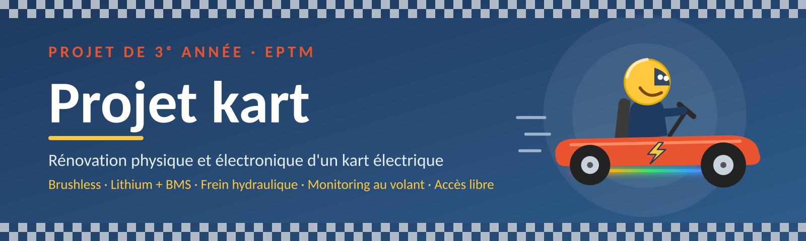

<p align="center">
  
</p>

<p align="center">
  <a href="https://eptm.ch"></a>
  
  <a href="CONTRIBUTING.md"></a>
</p>

<p align="center">
  <a href="LICENSES/CERN-OHL-P-2.0.txt"></a>
  <a href="LICENSES/MIT.txt"></a>
  <a href="LICENSES/CC-BY-4.0.txt"></a>
</p>

<p align="center">
  <b><a href="https://eptm.ch">🌐 Site de l'EPTM</a></b>
  &nbsp;·&nbsp;
  <b><a href="documentation/">📚 Documentation</a></b>
  &nbsp;·&nbsp;
  <b><a href="CONTRIBUTING.md">🤝 Contribuer</a></b>
</p>

---

## 🏁 Le projet

Le kart électrique de l'[EPTM](https://eptm.ch) est un projet de 3e année repris par les élèves d'une volée à l'autre. Chacun y apporte sa pierre : électronique, mécanique, logiciel ou documentation.

Ce dépôt rassemble ce travail **en accès libre**, pour que chaque nouvel élève puisse partir d'une base documentée, comprendre ce qui a déjà été fait et continuer à améliorer le kart, au lieu de tout redécouvrir.

## 📚 Travaux des élèves

| Année | Élève | Sujet | Documents |
|---|---|---|---|
| 2026 | Nathanaël Bachelard | Rénovation physique et électronique | [Cahier des charges](documentation/cahier_des_charges/Cahier_des_charges_kart_Bachelard.pdf) |

> Tu reprends le projet ? Ajoute ta ligne à ce tableau dans ta pull request.

## 📁 Structure du dépôt

```
EPTM_Kart_3rd_year_project/
├── documentation/   Cahiers des charges, rapports, notices
├── electronique/    Schémas et PCB (KiCad)
├── mecanique/       Modèles 3D et pièces (Fusion)
├── logiciel/        Code et firmware
├── assets/          Images du dépôt
└── LICENSES/        Textes complets des licences
```

## 🤝 Contribuer

Toute contribution passe par une **pull request** :

1. Fork le dépôt et crée une branche.
2. Fais tes modifications.
3. Ouvre une pull request en expliquant ce que tu as changé, pourquoi, et comment tu l'as testé.

Pour signaler un problème ou proposer une idée, ouvre une [issue](../../issues/new/choose). L'accès administrateur est réservé aux élèves de l'école : tout est expliqué dans le [guide de contribution](CONTRIBUTING.md).

## ⚠️ Sécurité

> [!WARNING]
> Le kart est un véhicule électrique alimenté par des batteries. Le contenu de ce dépôt est fourni **« tel quel », sans garantie** : toute reproduction ou modification se fait sous ta propre responsabilité.

## 📜 Licences

| Contenu | Licence |
|---|---|
| Matériel : schémas, KiCad, Fusion | [CERN-OHL-P-2.0](LICENSES/CERN-OHL-P-2.0.txt) |
| Code | [MIT](LICENSES/MIT.txt) |
| Documentation | [CC BY 4.0](LICENSES/CC-BY-4.0.txt) |

Détails dans [LICENSE.md](LICENSE.md).

---

<p align="center">
  🏎️ <i>Un projet des élèves de l'<a href="https://eptm.ch">EPTM</a>, d'une volée à l'autre.</i><br>
  <a href="https://eptm.ch"><b>🌐 eptm.ch</b></a>
</p>
