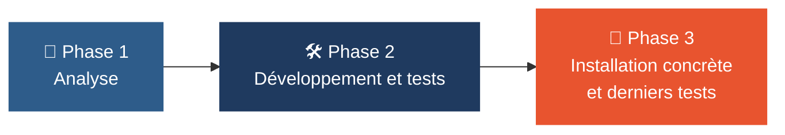

<p align="center">
  
</p>

<p align="center">
  
  
  
  <a href="CONTRIBUTING.md"></a>
</p>

<p align="center">
  <a href="LICENSES/CERN-OHL-P-2.0.txt"></a>
  <a href="LICENSES/MIT.txt"></a>
  <a href="LICENSES/CC-BY-4.0.txt"></a>
</p>

<p align="center">
  <b><a href="documentation/cahier_des_charges/Cahier_des_charges_kart_Bachelard.pdf">📄 Cahier des charges</a></b>
  &nbsp;·&nbsp;
  <b><a href="CONTRIBUTING.md">🤝 Contribuer</a></b>
  &nbsp;·&nbsp;
  <b><a href="LICENSE.md">📜 Licences</a></b>
</p>

---

## 🏁 Présentation

Le kart de l'école a déjà été le sujet des projets de nombreux élèves. Lors des portes ouvertes, son analyse a révélé plusieurs défauts, dont certains touchent à la sécurité. Avant de pouvoir lui ajouter de nouvelles fonctionnalités, comme un pilotage à distance, **le kart doit d'abord fonctionner correctement**.

Ce projet vise donc à proposer un **kart fonctionnel et au goût du jour**, grâce à une rénovation **physique et électronique**, et à en faire une **base solide** que les futurs élèves pourront reprendre et faire évoluer.

## 📑 Sommaire

- [État des lieux](#-état-des-lieux)
- [Objectifs et priorités](#-objectifs-et-priorités)
- [Sécurité](#-sécurité)
- [Organisation](#-organisation)
- [Structure du dépôt](#-structure-du-dépôt)
- [Outils](#-outils)
- [Contribuer](#-contribuer)
- [Licences](#-licences)

## 🔍 État des lieux

Défauts relevés lors des portes ouvertes :

| Élément | Constat |
|---|---|
| **Freinage** | Dangereux : il bloque et n'est pas synchronisé entre l'avant et l'arrière. La pédale est une simple barre mal fixée. |
| **Pneus** | Dégonflés et en mauvais état. |
| **Affichage au volant** | Câblage archaïque, afficheurs analogiques, glissières qui ne tiennent pas, écran mal fixé. |
| **Batteries et moteur** | Système ancien, à remplacer (état exact à confirmer lors de l'analyse). |

## 🎯 Objectifs et priorités

| Priorité | Domaine | Objectif |
|---|---|---|
| 🔴 **Indispensable** | Propulsion | Refaire toute la chaîne, de la batterie au moteur : batteries lithium avec BMS, contrôleur moteur (ESC) et moteur brushless |
| 🔴 **Indispensable** | Freinage | Frein hydraulique à disque, synchronisé entre l'avant et l'arrière, avec une vraie pédale |
| 🔴 **Indispensable** | Pneus | Remplacement des pneus |
| 🔵 **Souhaitable** | Monitoring au volant | Nouvel écran bien fixé : vitesse, tension et courant de la batterie, température du moteur et de l'ESC… |
| 🔵 **Souhaitable** | Pilotage à distance | Préparer le kart : consigne d'accélération transmise à l'ESC par un signal électrique standard |
| 🟢 **Optionnel** | Siège | D'abord des coussins ; un nouveau siège seulement si cela ne suffit pas |
| 🟢 **Optionnel** | Néons | Éclairage RGB sous le kart |
| 🟢 **Optionnel** | Revêtement | Habillage imprimé en 3D |

> [!NOTE]
> Le pilotage à distance ne fait pas partie de ce projet, mais la rénovation en est la première étape : le passage à un contrôleur moteur (ESC) faisait déjà partie des modifications nécessaires. Le détail complet se trouve dans le [cahier des charges](documentation/cahier_des_charges/Cahier_des_charges_kart_Bachelard.pdf).

## 🔋 Sécurité

Le passage aux batteries lithium impose les mesures suivantes :

| Mesure | Rôle |
|---|---|
| **BMS** (Battery Management System) | Protège le pack contre la surcharge, la décharge profonde, les surintensités et la surchauffe, et équilibre les cellules |
| **Fusible principal** | Placé au plus près de la batterie, il coupe le circuit en cas de court-circuit |
| **Coupe-circuit d'urgence** | Accessible au pilote, il permet de couper immédiatement l'alimentation |
| **Procédure de charge** | Charge avec un chargeur adapté aux batteries, selon une procédure définie et sous surveillance |

> [!WARNING]
> Le kart est un véhicule électrique alimenté par des batteries lithium. Le contenu de ce dépôt est fourni **« tel quel », sans garantie** : toute reproduction ou modification se fait sous ta propre responsabilité.

## 🗺️ Organisation

Le projet dure **3 mois** et s'organise en trois phases :



## 📁 Structure du dépôt

```
EPTM_Kart_3rd_year_project/
├── documentation/
│   └── cahier_des_charges/   Cahier des charges (PDF et Word)
├── electronique/             Schémas et PCB (KiCad)
├── mecanique/                Modèles 3D et pièces (Fusion)
├── logiciel/                 Code et firmware
├── assets/                   Images du dépôt
├── LICENSES/                 Textes complets des licences
├── CONTRIBUTING.md           Guide de contribution
└── LICENSE.md                Répartition des licences
```

## 🧰 Outils

| Domaine | Outil |
|---|---|
| Conception 3D | Fusion |
| Électronique | KiCad |
| Développement | VS Code |
| Partage et versionnage | GitHub |
| Assistance par IA | Claude |

## 🤝 Contribuer

Ce dépôt est fait pour être repris par les prochains élèves : **toute contribution passe par une pull request**.

1. Fork le dépôt et crée une branche.
2. Fais tes modifications.
3. Ouvre une pull request en expliquant ce que tu as changé, pourquoi, et comment tu l'as testé.

Pour signaler un problème ou proposer une amélioration, ouvre une [issue](../../issues/new/choose). L'accès administrateur est réservé aux élèves de l'école : voir le [guide de contribution](CONTRIBUTING.md).

## 📜 Licences

| Contenu | Licence |
|---|---|
| Matériel : schémas, KiCad, Fusion | [CERN-OHL-P-2.0](LICENSES/CERN-OHL-P-2.0.txt) |
| Code | [MIT](LICENSES/MIT.txt) |
| Documentation | [CC BY 4.0](LICENSES/CC-BY-4.0.txt) |

Détails dans [LICENSE.md](LICENSE.md).

---

<p align="center">
  Projet réalisé par <b>Nathanaël Bachelard</b> · EPTM · 2026<br>
  🏎️ <i>Prêt à rouler !</i>
</p>
